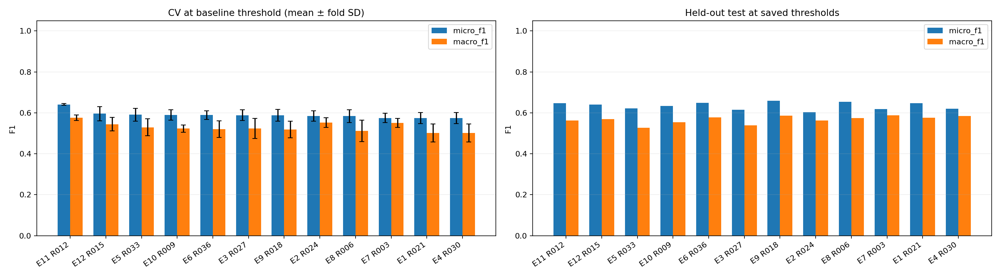
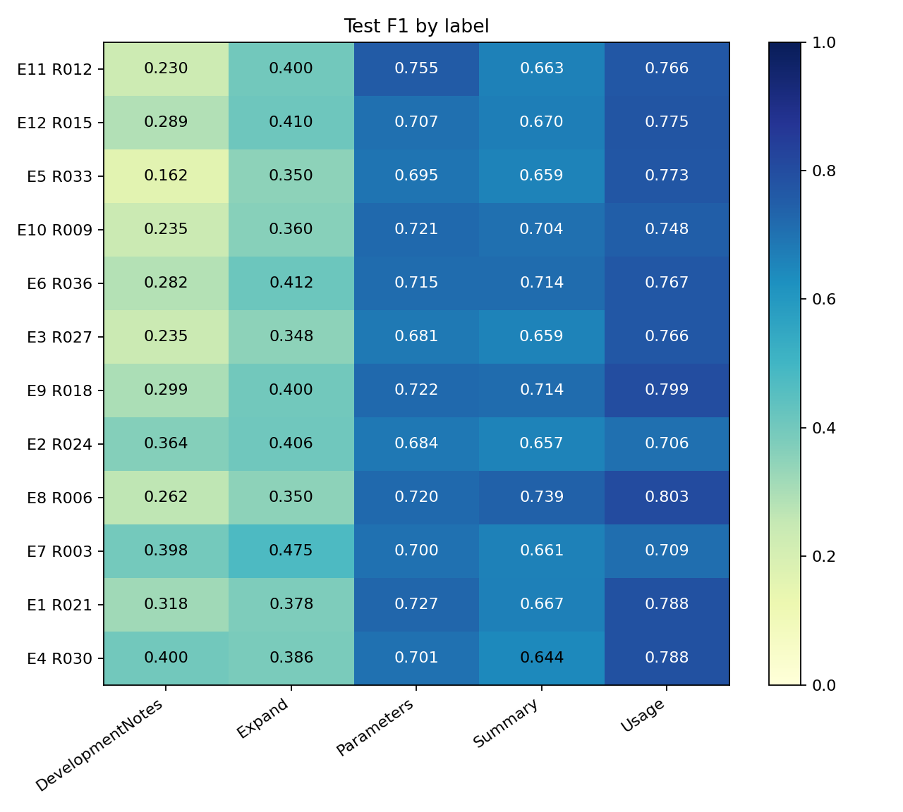
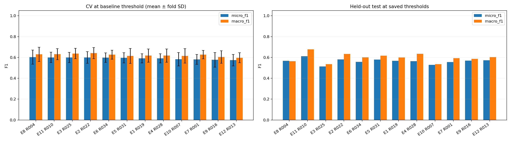
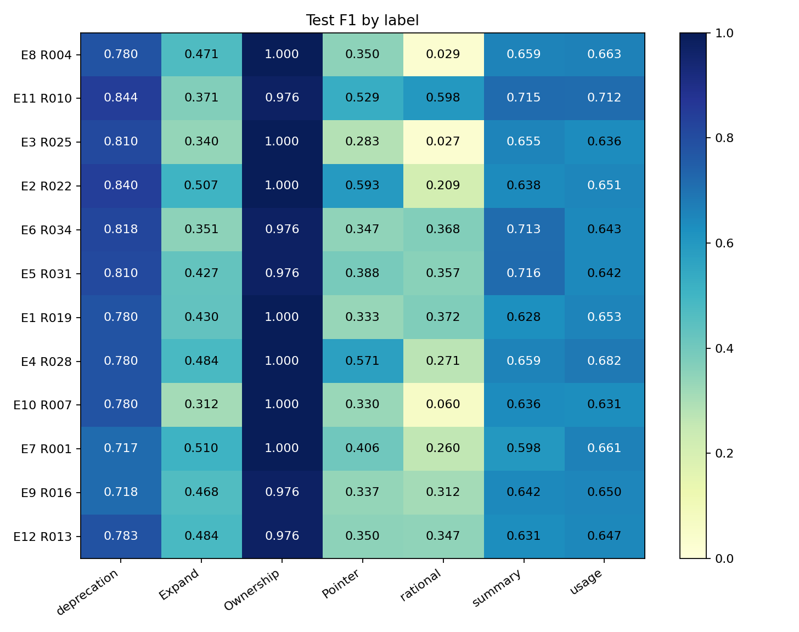
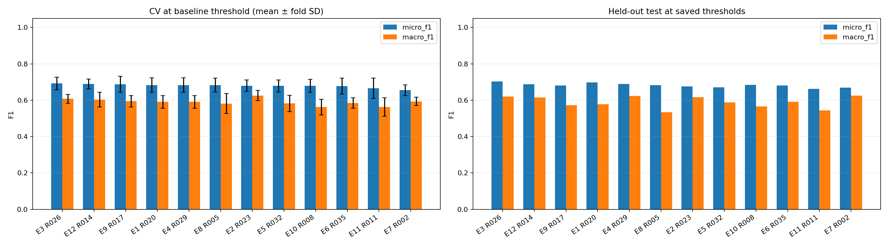
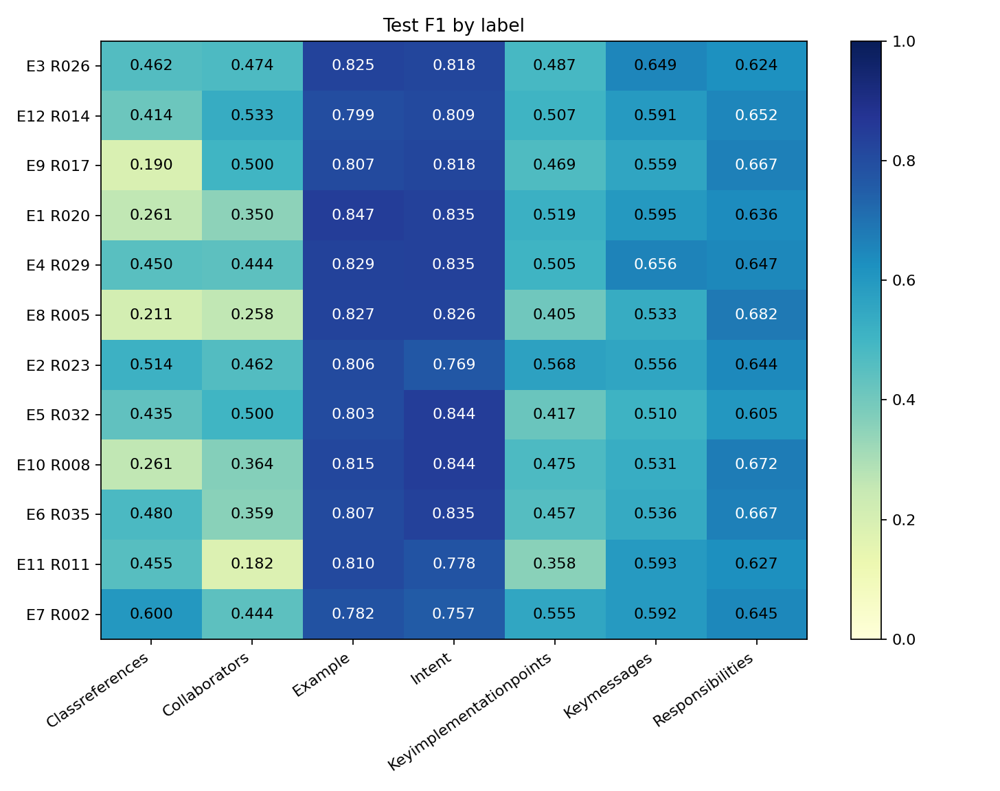

# Master-Seminar-2

**Project 2: Code Comment Classification** — phân loại đa nhãn 6.738 câu comment NLBSE’23 bằng RoBERTa/CodeBERT, với 12 phương pháp và cross-validation 5 fold.

- [Kết quả thực nghiệm và phân tích](#kết-quả-thực-nghiệm)
- [Hướng dẫn cài đặt và chạy](#hướng-dẫn-cài-đặt-và-chạy)
- [Báo cáo PDF đầy đủ](report.pdf)

## Kết quả thực nghiệm

Tài liệu tổng hợp **36 run hoàn chỉnh: 12 phương pháp × 3 ngôn ngữ**, sử dụng cùng dữ liệu processed và cùng folds trong từng ngôn ngữ. Các bảng được trích từ metric đã lưu, không phải số liệu minh họa. Thời điểm tổng hợp kết quả: 30/10/2026.

Báo cáo đầy đủ, EDA và các hình phân tích: [report.pdf](report.pdf).

### 1. Bài toán và dữ liệu

Mỗi câu comment có thể mang nhiều nhãn đồng thời. Mô hình nhận **văn bản một câu**, sinh xác suất sigmoid cho từng nhãn; không nhận toàn bộ class hay đoạn code đi kèm. Mỗi ngôn ngữ có một mô hình và hệ nhãn riêng.

Nguồn: [NLBSE’23 Tool Competition](https://nlbse2023.github.io/tools/). Nhánh **Code Comment Classification** có 6.738 câu và baseline gốc Random Forest; nhánh **Issue Report Classification** là bài toán khác. Trong dự án này, **E1 là baseline RoBERTa được huấn luyện lại theo cùng protocol với các biến thể**, đáp ứng yêu cầu so sánh Transformer của học phần.

| Ngôn ngữ | Tổng câu | Train | Test | Nhãn | CV folds |
| --- | --- | --- | --- | --- | --- |
| Python | 2555 | 2044 | 511 | 5 | 5 |
| Java | 2418 | 1934 | 484 | 7 | 5 |
| Pharo | 1765 | 1411 | 354 | 7 | 5 |

Dữ liệu nằm tại `data/processed/<language>/`, gồm `train.csv`, `test.csv`, `folds.json`, `label_cols.json`. Mỗi ID chỉ có một dòng sau pivot từ dữ liệu long; thứ tự nhãn lấy từ `label_cols.json`.

Text chỉ chuẩn hóa khoảng trắng. Các câu có text giống hệt được giữ cùng group khi chia train/test và train/validation, nhằm tránh rò rỉ nội dung trùng chính xác. Không tự động xóa các ID có cùng text nhưng khác nhãn.

EDA trong báo cáo cho thấy nhiều negative, nhãn hiếm, text lặp và sự tập trung theo class. Chỉ 5 câu Java vượt 128 token (3 train, 2 test); Python và Pharo không có câu vượt giới hạn này. Grouping chưa xử lý hết near-duplicate; class vẫn có thể xuất hiện ở cả train và test.

### 2. Protocol đánh giá

- **Bộ chia:** train/test xấp xỉ 80/20; 5-fold CV trên train, với ràng buộc nhóm text và cân bằng đa nhãn gần đúng. Không chia lại giữa các exp.
- **Khởi tạo:** mỗi fold dùng mô hình mới từ pretrained; seed cơ sở 42, seed fold bằng 42 cộng chỉ số fold.
- **Chọn checkpoint:** validation micro F1. CV báo trung bình và sample SD của năm fold tại best epoch từng fold.
- **Full train:** khởi tạo mô hình mới và huấn luyện toàn bộ train với trung vị best epoch của năm fold. Test không chọn epoch.
- **Chọn phương pháp:** CV micro F1 là tiêu chí chính. Các cột test dùng để báo cáo và phân tích, không dùng để chọn lại ứng viên.
- **Metric:** micro/macro F1, precision/recall, average precision (AP), Hamming loss (HL), và metric từng nhãn. F1/AP càng cao càng tốt; HL càng thấp càng tốt.

Ngưỡng mặc định là 0.5. E4 chọn ngưỡng từng nhãn bằng F1 trên dự đoán out-of-fold của train, lưới 0.05–0.95, bước 0.05. **CV E4 vẫn được báo ở ngưỡng 0.5; test E4 dùng ngưỡng đã tuning.** Vì vậy cột CV chưa phải đánh giá độc lập hiệu quả của toàn bộ bước tuning.

Cấu hình chung: RoBERTa-base hoặc CodeBERT-base, hidden size 768, max length 128, AdamW, learning rate `2e-5`, weight decay `0.01`, warmup 10%, linear scheduler, batch train/eval 16/32, gradient clipping 1, mixed precision tắt, tối đa 10 epoch. Mặc định early stopping patience 2. Mỗi run gồm 5 lượt CV và 1 lượt full train; tổng cộng 216 lượt fine-tune.

**Ngoại lệ E9 v2:** GNN residual với khởi tạo đầu phân loại tương thích baseline; patience 3, tối thiểu 5 epoch trước khi cho phép dừng, dùng micro AP phân xử khi validation F1 bằng nhau. Các kết quả E9 dưới đây đều là v2. Khác biệt này phải được tính đến khi diễn giải lợi ích của graph.

### 3. Các phương pháp và ý nghĩa thử nghiệm

| Exp | Mô hình | Mục tiêu/đối chứng |
| --- | --- | --- |
| E1 | RoBERTa + BCE | Baseline Transformer cùng protocol. |
| E2 | RoBERTa + Weighted BCE | Tăng chi phí bỏ sót positive; so với E1. |
| E3 | RoBERTa + Focal Loss | Tập trung cặp câu–nhãn khó; so với E1. |
| E4 | RoBERTa + Threshold Tuning | Đo tác động của quyết định ngưỡng; so với E1. |
| E5 | RoBERTa + Label-Aware Attention | Biểu diễn context riêng theo nhãn; so với E1. |
| E6 | RoBERTa + Attention + Contrastive Loss | Kiểm tra term contrastive bổ sung; so với E5. |
| E7 | RoBERTa + Asymmetric Loss (ASL) | Giảm easy negatives với focusing bất đối xứng; so với E1/E2/E3. |
| E8 | RoBERTa + R-Drop | Nhất quán giữa hai forward dropout bằng KL Bernoulli; so với E1. |
| E9 | RoBERTa + Label Correlation GNN v2 | Học phần hiệu chỉnh từ graph nhãn; so với E1. |
| E10 | RoBERTa + Adversarial Training (FGM) | Thêm nhiễu embedding một bước; so với E1. |
| E11 | CodeBERT + BCE | So sánh pretrained backbone chuyên về code; so với E1. |
| E12 | RoBERTa + Attention + Label Correlation GNN | Kiểm tra graph bổ sung trên context attention; so với E5. |

Graph và positive weight chỉ được tính từ training subset của từng fold; model cuối tính lại từ full train. Graph có 5/7/7 node theo ngôn ngữ, không sử dụng nhãn test. E9 và E12 thay cả biểu diễn node/khởi tạo nên không phải ablation chỉ thay một thành phần.

### 4. Kết quả đầy đủ

Thang điểm từ 0 đến 1, làm tròn bốn chữ số. CV là **mean ± SD**, AP trong bảng là **macro AP**. Chữ đậm chỉ giá trị tốt nhất từng cột trong cùng ngôn ngữ, không phải bằng chứng về ý nghĩa thống kê hoặc quy tắc chọn model bằng test.

Các biểu đồ bên dưới dùng cùng 36 run với bảng số liệu. Trục mô hình được sắp theo CV micro F1 giảm dần; `Rxxx` là mã run trong bản tổng hợp. Biểu đồ cột bên trái hiển thị CV mean ± SD giữa fold, bên phải hiển thị test ở ngưỡng đã lưu. Thanh sai số không phải khoảng tin cậy; riêng E4, CV ở ngưỡng 0.5 còn test ở ngưỡng OOF-tuned. Heatmap hiển thị F1 test từng nhãn, thang màu cố định 0–1.

#### Python

| Exp | CV micro F1 ± SD | Test micro F1 | Test macro F1 | Test macro AP | Test HL ↓ |
| --- | --- | --- | --- | --- | --- |
| E1 | 0.5747 ± 0.0273 | 0.6466 | 0.5755 | 0.6624 | 0.1472 |
| E2 | 0.5841 ± 0.0257 | 0.6039 | 0.5633 | 0.6407 | 0.1910 |
| E3 | 0.5885 ± 0.0263 | 0.6149 | 0.5381 | 0.6352 | 0.1554 |
| E4 | 0.5747 ± 0.0273 | 0.6196 | 0.5838 | 0.6624 | 0.1793 |
| E5 | 0.5906 ± 0.0307 | 0.6217 | 0.5279 | 0.6476 | 0.1558 |
| E6 | 0.5894 ± 0.0213 | 0.6491 | 0.5781 | 0.6626 | 0.1456 |
| E7 | 0.5750 ± 0.0232 | 0.6187 | **0.5885** | 0.6755 | 0.2137 |
| E8 | 0.5841 ± 0.0315 | 0.6539 | 0.5746 | 0.6653 | **0.1413** |
| E9 | 0.5874 ± 0.0290 | **0.6591** | 0.5867 | 0.6688 | **0.1413** |
| E10 | 0.5901 ± 0.0256 | 0.6337 | 0.5537 | 0.6487 | 0.1479 |
| E11 | **0.6410 ± 0.0047** | 0.6467 | 0.5627 | 0.6655 | 0.1479 |
| E12 | 0.5957 ± 0.0340 | 0.6399 | 0.5701 | **0.6763** | 0.1542 |



**Hình 1 — Python, so sánh tổng thể.** E11 dẫn CV nhưng test micro gần ngang E1; E9 có test micro cao nhất. Thứ hạng CV không chuyển nguyên vẹn sang test.



**Hình 2 — Python, F1 theo nhãn.** DevelopmentNotes và Expand khó hơn Parameters/Usage. E2 tăng DevelopmentNotes so với E1 nhưng giảm Usage; cải thiện nhãn hiếm có thể đi cùng giảm micro F1 tổng thể.

#### Java

| Exp | CV micro F1 ± SD | Test micro F1 | Test macro F1 | Test macro AP | Test HL ↓ |
| --- | --- | --- | --- | --- | --- |
| E1 | 0.5908 ± 0.0437 | 0.5679 | 0.5997 | 0.6550 | 0.1361 |
| E2 | 0.5997 ± 0.0565 | 0.5811 | 0.6339 | 0.6223 | 0.1744 |
| E3 | 0.6001 ± 0.0488 | 0.5143 | 0.5358 | 0.6242 | 0.1555 |
| E4 | 0.5908 ± 0.0437 | 0.5650 | 0.6354 | 0.6550 | 0.1936 |
| E5 | 0.5957 ± 0.0489 | 0.5800 | 0.6165 | 0.6441 | 0.1316 |
| E6 | 0.5977 ± 0.0459 | 0.5571 | 0.6022 | 0.6559 | 0.1432 |
| E7 | 0.5809 ± 0.0472 | 0.5565 | 0.5931 | 0.6345 | 0.2004 |
| E8 | **0.6029 ± 0.0680** | 0.5682 | 0.5647 | 0.6408 | 0.1346 |
| E9 | 0.5773 ± 0.0698 | 0.5698 | 0.5861 | 0.6640 | 0.1319 |
| E10 | 0.5830 ± 0.0638 | 0.5290 | 0.5355 | 0.6529 | 0.1367 |
| E11 | 0.6006 ± 0.0501 | **0.6110** | **0.6778** | **0.6937** | **0.1278** |
| E12 | 0.5742 ± 0.0549 | 0.5735 | 0.6024 | 0.6358 | 0.1414 |



**Hình 3 — Java, so sánh tổng thể.** E8 dẫn CV nhẹ, còn E11 dẫn test micro/macro F1. SD fold tương đối lớn, nên không khẳng định ưu thế chỉ từ khoảng cách nhỏ giữa hai giá trị CV trung bình.



**Hình 4 — Java, F1 theo nhãn.** Ownership gần hoàn hảo ở nhiều mô hình, trong khi Pointer và rational khó hơn. Điểm cao của một nhãn dễ không đại diện cho chất lượng đồng đều trên toàn hệ nhãn.

#### Pharo

| Exp | CV micro F1 ± SD | Test micro F1 | Test macro F1 | Test macro AP | Test HL ↓ |
| --- | --- | --- | --- | --- | --- |
| E1 | 0.6832 ± 0.0403 | 0.6970 | 0.5777 | 0.6307 | 0.0940 |
| E2 | 0.6800 ± 0.0307 | 0.6754 | 0.6171 | 0.6579 | 0.1207 |
| E3 | **0.6923 ± 0.0347** | **0.7028** | 0.6197 | 0.6707 | **0.0928** |
| E4 | 0.6832 ± 0.0403 | 0.6895 | 0.6239 | 0.6307 | 0.1061 |
| E5 | 0.6787 ± 0.0331 | 0.6711 | 0.5876 | 0.6729 | 0.1009 |
| E6 | 0.6776 ± 0.0432 | 0.6813 | 0.5915 | 0.6622 | 0.0993 |
| E7 | 0.6547 ± 0.0300 | 0.6686 | **0.6250** | **0.6934** | 0.1360 |
| E8 | 0.6832 ± 0.0385 | 0.6829 | 0.5346 | 0.6562 | 0.0944 |
| E9 | 0.6878 ± 0.0438 | 0.6813 | 0.5728 | 0.6509 | 0.0997 |
| E10 | 0.6787 ± 0.0356 | 0.6844 | 0.5659 | 0.6535 | 0.0960 |
| E11 | 0.6656 ± 0.0552 | 0.6622 | 0.5431 | 0.6249 | 0.1013 |
| E12 | 0.6893 ± 0.0263 | 0.6879 | 0.6150 | 0.6762 | 0.0989 |



**Hình 5 — Pharo, so sánh tổng thể.** E3 dẫn CV và test micro F1; E7 có macro F1 tốt nhất nhưng micro thấp hơn E1. Mục tiêu nhãn hiếm và mục tiêu tổng thể có thể dẫn tới lựa chọn khác nhau.



**Hình 6 — Pharo, F1 theo nhãn.** E7 cải thiện Classreferences so với E1 nhưng giảm Example. Cần đánh giá đồng thời từng nhãn, micro và macro thay vì chỉ chọn một cột điểm cao nhất.

### 5. Lựa chọn theo CV và đánh giá trên test

Các ứng viên dưới đây được xác định bằng CV micro F1. “Chênh test” là chênh test micro F1 so với E1, đơn vị **điểm phần trăm**; không phải phần trăm tăng tương đối.

| Ngôn ngữ | Chọn theo CV | CV micro F1 ± SD | Test micro F1 | E1 test micro F1 | Chênh test (điểm %) |
| --- | --- | --- | --- | --- | --- |
| Python | E11 | 0.6410 ± 0.0047 | 0.6467 | 0.6466 | +0.01 |
| Java | E8 | 0.6029 ± 0.0680 | 0.5682 | 0.5679 | +0.02 |
| Pharo | E3 | 0.6923 ± 0.0347 | 0.7028 | 0.6970 | +0.58 |

Trung bình đều test micro F1 của tổ hợp chọn bằng CV là **0.6393**, so với **0.6372** của E1: tăng khoảng **0.21 điểm phần trăm**. Đây là trung bình ba bài toán theo ngôn ngữ, không phải pooled F1 của mô hình 19 nhãn.

Nếu cần một kỹ thuật dùng chung, E11 có trung bình đều CV micro F1 cao nhất, **0.6357**; E1 là **0.6162**. Lựa chọn này vẫn phải chấp nhận điểm yếu của CodeBERT trên Pharo.

### 6. Phân tích và insight

#### 6.1. Không có mô hình thắng đồng nhất

- **Python:** E11 tăng CV rõ so với E1 (0.6410 so với 0.5747), nhưng test micro gần như ngang nhau (0.6467 so với 0.6466). E9 v2 có test micro cao nhất 0.6591, nhưng không đứng đầu CV. Không chuyển gain CV thành lời khẳng định gain test tương đương.
- **Java:** E8 dẫn CV nhẹ; E11 đứng gần phía sau và đạt test micro/macro/AP cao nhất. Khoảng cách CV giữa E8 và E11 nhỏ so với SD fold. Không đổi lựa chọn sang E11 chỉ vì đã thấy test cao hơn rồi gọi đó là đánh giá độc lập.
- **Pharo:** E3 dẫn CV và test micro; E7 dẫn test macro F1 và macro AP nhưng micro thấp hơn E1. Lựa chọn khác nhau tùy mục tiêu tổng thể hay nhãn hiếm.

#### 6.2. Threshold tuning đổi đánh đổi FP/FN

E4 giữ macro AP như E1 ở cả ba ngôn ngữ, nhưng tăng macro F1, giảm micro F1 và tăng Hamming loss. Điều này phù hợp với việc giữ thứ hạng xác suất nhưng đổi quyết định từng nhãn. Tối ưu F1 riêng mỗi nhãn không trực tiếp tối ưu micro F1.

| Ngôn ngữ | Exp | Micro precision | Micro recall | FP | FN |
| --- | --- | --- | --- | --- | --- |
| Python | E1 | 0.7006 | 0.6003 | 147 | 229 |
| Python | E4 | 0.5911 | 0.6510 | 258 | 200 |
| Java | E1 | 0.6048 | 0.5353 | 198 | 263 |
| Java | E4 | 0.4522 | 0.7527 | 516 | 140 |
| Pharo | E1 | 0.7424 | 0.6569 | 93 | 140 |
| Pharo | E4 | 0.6651 | 0.7157 | 147 | 116 |

Java giảm FN từ 263 xuống 140 nhưng FP tăng từ 198 lên 516. Vì vậy không thể kết luận threshold tuning “tốt hơn” chỉ từ macro F1. Khi bỏ sót nhãn có giá cao, cần ưu tiên recall; khi FP gây phiền, phải đọc precision và HL cùng F1. Mục tiêu nên được chốt trước khi chọn bằng validation.

#### 6.3. Loss và imbalance không có lời giải chung

E2 cải thiện một số nhãn hiếm nhưng có thể làm giảm nhãn phổ biến; tác động micro/macro khác nhau theo ngôn ngữ. ASL E7 tăng recall nhưng precision thấp hơn E1. Trên Pharo, macro AP cao của E7 cho thấy thứ hạng hữu ích, trong khi quyết định ở ngưỡng 0.5 chưa đạt micro F1 tốt nhất. Focal Loss tốt ở Pharo nhưng giảm test Java. Có mất cân bằng không đồng nghĩa class weight hoặc loss phức tạp luôn tốt hơn BCE.

#### 6.4. Attention và graph cần lợi ích được kiểm chứng

E5 chỉ tăng test micro trên Java so với E1. E6 cải thiện E5 trên Python/Pharo nhưng giảm trên Java. E12 tăng micro/macro so với E5 ở Python/Pharo, giảm ở Java. Graph full train chỉ có 3/3/6 cạnh ngoài self-loop tại ngưỡng cosine 0.1; prior nhãn khá thưa. Đồng xuất hiện không phải quan hệ nhân quả hay luật gán nhãn chắc chắn. Chưa có ablation nhiều seed để quy lợi ích riêng cho graph.

#### 6.5. Pretraining phải phù hợp miền

E11 tăng CV micro ở Python/Java nhưng giảm ở Pharo; test Java cải thiện rõ, Python gần ngang baseline, Pharo giảm. Python/Java có trong các ngôn ngữ code pretrain của CodeBERT, còn Pharo không có; đây là giả thuyết phù hợp miền, chưa chứng minh là nguyên nhân duy nhất. Quy mô mẫu và phân bố class cũng có thể đóng góp.

### 7. Hội tụ và chi phí

Số epoch model cuối là trung vị best epoch CV, không phải số epoch thực chạy của mọi fold. Thời gian dưới đây bao gồm 5-fold CV, full train và evaluation; không phải inference latency.

| Exp | Python: epoch / phút | Java: epoch / phút | Pharo: epoch / phút |
| --- | --- | --- | --- |
| E1 | 7 / 14.84 | 6 / 12.88 | 7 / 11.16 |
| E2 | 7 / 15.69 | 4 / 11.13 | 7 / 11.60 |
| E3 | 5 / 12.96 | 6 / 12.92 | 9 / 11.93 |
| E4 | 7 / 15.07 | 6 / 13.09 | 7 / 11.29 |
| E5 | 6 / 14.84 | 6 / 14.03 | 7 / 11.62 |
| E6 | 7 / 15.47 | 6 / 13.74 | 7 / 12.01 |
| E7 | 9 / 18.33 | 7 / 14.11 | 9 / 12.60 |
| E8 | 7 / 27.04 | 6 / 23.93 | 6 / 17.65 |
| E9 | 7 / 15.79 | 5 / 12.81 | 7 / 11.98 |
| E10 | 9 / 36.98 | 6 / 29.33 | 10 / 26.37 |
| E11 | 7 / 16.32 | 6 / 12.74 | 7 / 11.91 |
| E12 | 9 / 17.57 | 6 / 12.93 | 8 / 12.15 |

E8 có thời gian pipeline quan sát khoảng 1.58–1.86 lần E1; E10 khoảng 2.28–2.49 lần. E10 không cải thiện test micro/macro so với E1 trên cả ba ngôn ngữ trong cấu hình này. Epoch thực chạy, GPU và tải chạy đồng thời khác nhau nên không coi các tỷ lệ này là benchmark tốc độ được kiểm soát.

Một số fold còn cải thiện tới epoch 10, một số đạt đỉnh sớm. Không có căn cứ bắt mọi model dừng ở 5 epoch hoặc luôn chạy đủ 10. Cần early stopping, khôi phục best weights và xác nhận bằng validation nếu tăng ngân sách.

### 8. Giới hạn và phạm vi kết luận

1. **Một seed cơ sở:** SD giữa fold không thay thế đánh giá nhiều seed và không phải khoảng tin cậy. Các chênh lệch nhỏ chưa được chứng minh có ý nghĩa thống kê.
2. **CV dùng chọn epoch:** điểm best validation có thiên lệch lựa chọn; chưa dùng nested CV. OOF sau khi tuning threshold cũng không phải đánh giá độc lập.
3. **Test đã được quan sát:** kết quả mang tính thăm dò; không mô tả test hiện tại là benchmark mù. Cần holdout mới hoặc protocol xác nhận mới để kiểm chứng các thay đổi tiếp theo.
4. **Khác partition gốc:** bộ chia group chung phục vụ joint multi-label và k-fold; không tuyên bố vượt baseline Random Forest chính thức trên cùng protocol cuộc thi.
5. **Khác chính sách E9:** khởi tạo head và checkpoint/early stopping riêng; chưa thể quy gain chỉ cho GNN.
6. **Tổng quát hóa:** class giao giữa train/test, near-duplicate chưa được loại hết, input chỉ có một câu; chưa xác nhận khả năng chuyển sang project hoàn toàn mới.
7. **Phạm vi source:** kết quả này chỉ thuộc pipeline DL E1–E12. Các script/report ML cũ không phải bằng chứng đánh giá joint multi-label trong tài liệu này.

### 9. Nguồn số liệu và tái lập

Nguồn cục bộ dùng để tổng hợp là `results/model_zoo/leaderboard.csv` và `metrics.json` của 36 run đã giữ lại theo `results/training/CLEANUP_MANIFEST.json`. Các bảng được đối soát với metric từng run và fingerprint dữ liệu. Mỗi exp/ngôn ngữ giữ một run hoàn chỉnh; E9 chỉ sử dụng head v2, không chọn run bằng test cao nhất.

Các thư mục training/model zoo đang được `.gitignore` loại trừ. Vì vậy, sau khi clone repo, các đường dẫn kết quả cục bộ trên **không mặc nhiên tồn tại**. Sáu hình so sánh và heatmap được sao chép nguyên bản sang `docs/images/results/`, ngoài vùng ignore, và nhúng bằng đường dẫn tương đối để hiển thị trên GitHub. Các hình được quản lý cùng README trong repository. PDF chứa thêm các hình và phân tích đầy đủ; checkpoint lớn không được nhúng vào Markdown.

#### Fingerprint SHA-256 của dữ liệu

Hash được tính từ tên và nội dung lần lượt `train.csv`, `test.csv`, `folds.json`, `label_cols.json`, theo đúng loader thực nghiệm.

| Ngôn ngữ | Fingerprint |
| --- | --- |
| Python | `1e77a6d33beb1547394723d2062e0cc94cae6fb39ba5c17071a31d01013b52bf` |
| Java | `0d2c2c9066d93d74db835f53e6fc949c21ba4a6cb14b7e5f5b4182ce1451875e` |
| Pharo | `23a6634e63a4a6e93d00399ddfe582583201a4328fdfe671e25805ac39eb1c7e` |

Lần kiểm tra source gần nhất: **26 tests pass**. Đây là kiểm tra phần mềm, không thay thế việc chạy đánh giá chất lượng mô hình. Hướng dẫn tái lập nằm trong phần cài đặt và chạy bên dưới.

## Hướng dẫn cài đặt và chạy

### Model Zoo: danh mục, training và so sánh kết quả

Registry dùng chung nằm trong `src/models/dl/zoo.py`; mỗi E1–E12 có tên kiến trúc,
variant và config. Có thể tiếp tục dùng `train_exp1`–`train_exp12` hoặc dùng CLI chung:

```bash
# Xem các model/config được hỗ trợ (không tải model)
python3 -m experiments.dl.model_zoo list

# Train một model
python3 -m experiments.dl.model_zoo train --exp E3 --language python --device cuda:0

# Tổng hợp các lần training đã hoàn tất, kể cả các thư mục chạy trên hai GPU
python3 -m src.evaluation.analyze_results --results results/training --output-dir results/model_zoo
```

Phân tích chỉ đọc `metrics.json`, không tải checkpoint và không train lại. Có thể
truyền nhiều thư mục sau `--results`, hoặc truyền trực tiếp các file metrics.
Script Bash tự chạy phân tích sau khi toàn bộ các lượt được chọn hoàn tất thành công,
lưu báo cáo vào `<output-root>/model_zoo/`. Lệnh phân tích riêng ở trên dùng để
tổng hợp thêm kết quả từ nhiều lần gọi script, ví dụ các nhóm exp chạy trên hai GPU.
Kết quả gồm:

- `report.md`: danh mục model, số run, bảng so sánh, liên kết tới metrics và biểu đồ.
- `leaderboard.csv`: CV mean/std, test metrics, seed, device, epoch, thời gian,
  đường dẫn checkpoint/threshold và trạng thái tồn tại checkpoint.
- `per_label.csv`: precision, recall, F1, AP và support theo nhãn cho mỗi run.
- `<language>-<cohort>/comparison.png`: CV micro/macro F1 ± SD và test F1.
- `<language>-<cohort>/per_label_f1.png`: heatmap test F1 của các model theo nhãn.

Các run chỉ được so sánh chung khi cùng ngôn ngữ, hash nội dung train/test/folds/labels,
thứ tự nhãn và split protocol. Run cũ thiếu hash được để riêng. Mỗi run/seed là một
dòng, không tự gộp hoặc chọn run có test cao nhất. Bảng sắp theo CV micro F1;
CV của E4 vẫn ở threshold ban đầu, test dùng threshold đã tuning từ OOF.
Nếu chưa có training hoàn tất, công cụ báo chưa tìm thấy kết quả, không sinh số liệu mẫu.

Trong terminal, training có `tqdm` theo batch với loss hiện tại, loss trung bình,
learning rate, tốc độ và thời gian ước tính; validation/test cũng có tiến độ.
Script Bash vẫn hiển thị tiến độ khi dùng `tee`. Khi chuyển hướng ra file không có
terminal, mặc định chỉ ghi log theo epoch. Dùng `MODEL_ZOO_PROGRESS=on` để luôn
hiện thanh tiến độ, `MODEL_ZOO_PROGRESS=off` để tắt; hoặc `training.progress: false`
trong config để tắt cho cả train và evaluation.

Sau mỗi exp/ngôn ngữ, đồ thị từng run tự lưu trong `plots/`:
`training_curves.png`, `cross_validation.png`, `test_summary.png`, `test_per_label.png`.
Hai biểu đồ test chỉ có khi bật đánh giá test. Metrics được lưu trước khi vẽ hình.

Chạy từ thư mục gốc repository. Cài dependencies:

```bash
python3 -m pip install -r requirements.txt
```

Mọi exp đọc `data/processed/<language>/{train.csv,test.csv,folds.json,label_cols.json}`.
Không chia lại dữ liệu, không đọc partition raw. Mỗi ngôn ngữ được train riêng:
Python có 5 nhãn, Java và Pharo có 7 nhãn, theo đúng thứ tự `label_cols.json`.
Loader kiểm tra schema, nhãn nhị phân, ID, nhóm câu trùng, train/test và độ phủ CV.
Tạo dữ liệu trước bằng `notebooks/data_preprocessing.ipynb`; xem `data/README.md`.

| Exp | Mô hình | Config |
|---|---|---|
| E1 | RoBERTa CLS + BCE | `configs/exp1_roberta_baseline.yaml` |
| E2 | RoBERTa CLS + Weighted BCE | `configs/exp2_roberta_weighted_bce.yaml` |
| E3 | RoBERTa CLS + Focal Loss | `configs/exp3_roberta_focal.yaml` |
| E4 | RoBERTa CLS + BCE + threshold tuning | `configs/exp4_roberta_threshold_tuning.yaml` |
| E5 | RoBERTa + Label-Aware Attention + BCE | `configs/exp5_roberta_label_attention.yaml` |
| E6 | RoBERTa + Label-Aware Attention + BCE + Contrastive Loss | `configs/exp6_roberta_label_attention_contrastive.yaml` |
| E7 | RoBERTa + Asymmetric Loss | `configs/exp7_roberta_asl.yaml` |
| E8 | RoBERTa + R-Drop | `configs/exp8_roberta_rdrop.yaml` |
| E9 | RoBERTa + Label Correlation GNN theo từng ngôn ngữ (5/7/7 nhãn) | `configs/exp9_roberta_label_gnn.yaml` |
| E10 | RoBERTa + Adversarial Training FGM | `configs/exp10_roberta_fgm.yaml` |
| E11 | CodeBERT + BCE | `configs/exp11_codebert_bce.yaml` |
| E12 | RoBERTa + Label-Aware Attention + Label Correlation | `configs/exp12_roberta_label_attention_gnn.yaml` |


Chi tiết công thức, tham số và nguồn tham khảo cho E7–E12: [docs/experiments_e7_e12.md](docs/experiments_e7_e12.md).
E9 được chốt dùng graph theo từng ngôn ngữ, tự đọc số node/thứ tự nhãn từ
`label_cols.json`: Python 5, Java 7, Pharo 7. E12 dùng cùng hệ nhãn này.
Graph chỉ tính từ fold train; `label_graph.json` lưu graph full train và thông tin node/cạnh.

Ví dụ chạy E1 cho Python, E6 cho Java hoặc E2 cho cả ba ngôn ngữ:

```bash
python3 -m experiments.dl.train_exp1 --language python
python3 -m experiments.dl.train_exp6 --language java
python3 -m experiments.dl.train_exp2 --language all
```

Tương tự, dùng `train_exp3`, `train_exp4`, `train_exp5` cho các exp còn lại.
Có thể chạy tuần tự bằng Bash:

```bash
# Kiểm tra lệnh trước khi chạy
bash scripts/train_experiments.sh --dry-run

# E1–E12 trên Python
bash scripts/train_experiments.sh --language python

# Chọn exp và ngôn ngữ
bash scripts/train_experiments.sh --experiments 1,2,6 --language java

# E1–E12 trên cả 3 ngôn ngữ (36 lượt chạy)
bash scripts/train_experiments.sh
```

Script dùng Python của môi trường hiện tại; có thể chỉ định `--python /path/to/python`.
Kết quả mặc định nằm trong `results/training/<timestamp>-<pid>/exp<N>/<language>/`,
có `training.log` cho từng lượt. Dùng `--output-dir PATH` để chọn thư mục gốc khác.
Script dừng khi có lỗi; `--dry-run` không chạy training hoặc tạo output.

Mặc định chạy Python. Có thể dùng `--config PATH`, `--data-dir data/processed`
và `--output-dir PATH`. Với `--language all`, output tùy chỉnh được thêm thư mục ngôn ngữ.
Lần chạy đầu tải backbone/tokenizer `roberta-base` từ Hugging Face.

### Chọn CPU hoặc GPU

`--device auto` dùng GPU 0 nếu CUDA khả dụng, ngược lại dùng CPU.
`--device cpu`, `--device cuda:0`, `--device cuda:1` chọn thiết bị cụ thể.
Chọn GPU khi CUDA không khả dụng hoặc index không tồn tại sẽ báo lỗi trước khi
tải model. Thiết bị được in ra terminal và lưu trong config/metrics của run.
Với lệnh Python trực tiếp, mặc định lấy `training.device` trong YAML (`auto`);
script Bash mặc định truyền `auto`, hoặc giá trị bạn chỉ định qua `--device`.

Kiểm tra trong chính môi trường Python định dùng:

```bash
python3 -c 'import torch; print(torch.__version__); print("CUDA:", torch.cuda.is_available()); print("GPUs:", torch.cuda.device_count())'

# Một exp trên GPU 1
python3 -m experiments.dl.train_exp1 --language python --device cuda:1

# E1–E12 trên GPU 0
bash scripts/train_experiments.sh --language python --device cuda:0

# Dùng Python từ môi trường có PyTorch hỗ trợ CUDA
bash scripts/train_experiments.sh --python /path/to/environment/bin/python --device cuda:0
```

Nếu phiên bản PyTorch có hậu tố `+cpu` và CUDA là `False`, cần dùng môi trường
có PyTorch hỗ trợ CUDA; cờ `--device` không thể bổ sung CUDA cho bản CPU.

Để tận dụng hai GPU, mở hai terminal và phân exp khác nhau:

```bash
# Terminal 1: E1–E3, cả 3 ngôn ngữ, GPU 0
bash scripts/train_experiments.sh --experiments 1,2,3 --language all --device cuda:0

# Terminal 2: E4–E6, cả 3 ngôn ngữ, GPU 1
bash scripts/train_experiments.sh --experiments 4,5,6 --language all --device cuda:1
```

Mỗi terminal chạy tuần tự trên một GPU; hai terminal chạy song song. Mỗi model
chỉ dùng một GPU, chưa dùng DDP. Theo dõi bằng `watch -n 1 nvidia-smi`.
Index CUDA tính theo các GPU đang hiển thị cho process: nếu đặt
`CUDA_VISIBLE_DEVICES=1`, card vật lý 1 sẽ trở thành `cuda:0` trong process đó.

### Chạy các exp bổ sung E7–E12

```bash
# GPU 0: E7–E9
bash scripts/train_experiments.sh --experiments 7,8,9 --language all --device cuda:0

# GPU 1: E10–E12
bash scripts/train_experiments.sh --experiments 10,11,12 --language all --device cuda:1
```

Các exp mới có tối đa 10 epoch; mặc định patience 2, riêng E9 v2 patience 3,
chạy tối thiểu 5 epoch trước khi cho phép early stop và dùng AP phân xử khi F1 bằng nhau.
GNN ước lượng graph riêng từ
fold train; R-Drop dùng hai forward khi train; FGM nhiễu input embeddings; E11
nạp đúng tokenizer/backbone `microsoft/codebert-base`. Chi tiết tại tài liệu ở trên.

### Quy trình chung

Mỗi fold khởi tạo lại model từ pretrained backbone, tokenize (padding/truncation,
`max_length=128` mặc định), train và chọn epoch theo validation micro F1.
Giới hạn mặc định là **10 epoch/fold**, early stopping patience **2**;
E9 v2 dùng patience **3**, tối thiểu **5 epoch**, AP phân xử khi F1 bằng nhau.
Model được khôi phục về epoch tốt nhất. Sau CV, khởi tạo model mới và train trên
full train với số epoch bằng trung vị best epoch của các fold, rồi đánh giá test.

E9 v2 khởi tạo từ head CLS baseline, nhánh GCN khởi tạo hiệu chỉnh bằng 0 và
không chia logit cho `sqrt(768)`. Phải train lại E9 từ pretrained, không nạp checkpoint
head cũ. Có thể kiểm tra riêng epoch đầu, giữ nguyên LR schedule 10 epoch:

```bash
python3 -m experiments.dl.check_exp9_first_epoch --language all --fold 0 --device cuda:0
```

Script lưu diagnostic vào `results/diagnostics/`, không chạy test hoặc toàn bộ CV.
Seed, optimizer, lịch learning rate và folds giống nhau giữa các exp theo mặc định.
Một exp/ngôn ngữ chạy 5 model CV và 1 model cuối. Không dùng test để chọn cấu hình.

- **E2:** `pos_weight = negative / positive`, tính lại trên train của từng fold;
  model cuối tính từ full train. Nhãn không có positive hoặc negative dùng weight 1.
- **E3:** sigmoid focal loss `alpha_t * (1-p_t)^gamma * BCE`, mặc định `gamma=2`,
  `alpha=null` (không alpha weighting). Có thể chỉnh trong config.
- **E4:** chọn threshold riêng cho từng nhãn bằng F1 trên dự đoán out-of-fold của
  full train, grid 0.05–0.95 bước 0.05. Hòa điểm ưu tiên gần 0.5. Sau đó cố định
  threshold để đánh giá model cuối trên test. CV metrics vẫn dùng threshold 0.5;
  không coi F1 trên OOF đã tuning là ước lượng độc lập. Threshold là hậu xử lý,
  phải nạp `thresholds.json` khi inference; riêng state dict không chứa threshold.
- **E5:** mỗi nhãn có query học được, attention trên các token không padding,
  tạo context và logit riêng cho từng nhãn; tối ưu BCE.
- **E6:** cùng kiến trúc attention, thêm phép chiếu CLS. Contrastive loss dùng
  cosine similarity giữa CLS đã chiếu và query nhãn, chia temperature, rồi
  cross-entropy với target phân bố đều trên các nhãn dương của câu. Các nhãn còn
  lại là negative. `loss = BCE + 0.1 * contrastive`, temperature mặc định 0.1.
  Đây là biến thể sentence–label contrastive; không phải pairwise sentence contrastive.

### Kết quả và sử dụng lại model

Output: `results/<experiment>/<language>/`, gồm:

- `best_model.pt`: state dict model cuối train full train.
- `config.yaml`, `dataset_config.yaml`, `label_cols.json`, `folds.json`.
- `tokenizer/`, `thresholds.json` (thứ tự theo label_cols).
- `metrics.json`: chỉ số từng fold, mean/sample SD, best epoch, test,
  class weights cho E2 và thresholds cho E4.
- `oof_predictions.pt` riêng E4, chứa xác suất và nhãn theo thứ tự train.csv.
- `tensorboard/` và `plots/`: loss, validation/test metrics, biểu đồ tổng hợp.

Khởi tạo đúng kiến trúc theo `variant` trong config, nạp state dict, tokenizer và
thứ tự nhãn. Dự đoán bằng `sigmoid(logits) >= thresholds`; mọi exp trừ E4 mặc định 0.5.
Một thư mục output chứa một kết quả cuối; chạy lại cùng đường dẫn sẽ ghi đè model
và metrics (TensorBoard có thư mục theo thời gian). Dùng `--output-dir` cho run riêng.

```bash
tensorboard --logdir results
```

Metrics chung: micro/macro precision, recall, F1, average precision, Hamming loss
và kết quả theo nhãn. Average precision không xác định được ghi `null`.

### Báo cáo thực nghiệm

[report.pdf](report.pdf) trình bày bài toán, dữ liệu, tiền xử lý, E1–E12,
kết quả của 36 run, so sánh với RoBERTa, phân tích theo nhãn, hội tụ,
chi phí và giới hạn thực nghiệm. Báo cáo có bảng biểu, hình minh họa và
tài liệu tham khảo; không chèn source code. Mục 2 (trang 6–16) trình bày
EDA với 10 hình về độ dài/token, truncation, cardinality, từ vựng, quan hệ
nhãn, train/test, các fold và nguy cơ leakage, trước phần dữ liệu và tiền xử lý
ở Mục 3. Chỉ giữ bản PDF cuối cùng.

### Kiểm tra offline

```bash
USE_TF=0 python3 -m unittest discover -s tests -v
```

Các kiểm tra dùng backbone RoBERTa nhỏ khởi tạo ngẫu nhiên để kiểm tra đường chạy,
không tải pretrained weights và không đánh giá chất lượng mô hình.
