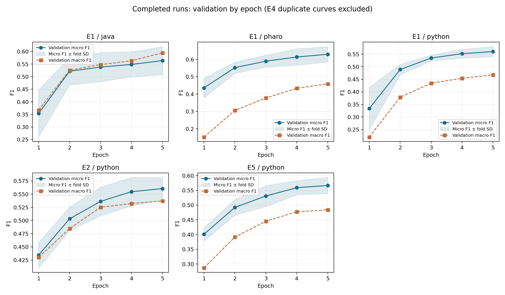

# Đánh giá giới hạn 5 epoch

Mốc đọc kết quả: 2026-10-29T11:43:21+07:00.

## Kết luận

Chưa nên chốt 5 epoch là đủ. Đề xuất lượt thử tiếp theo: tối đa 10 epoch, early_stopping_patience = 3, chọn epoch theo validation micro F1 và khôi phục best weights. Đây là giới hạn thử, chưa phải số epoch tối ưu đã được đo.

| Model | Ngôn ngữ | Best epoch từng fold | Best tại epoch 5 | Val micro F1 epoch 4 → 5 | Val macro F1 epoch 4 → 5 |
|---|---|---|---:|---:|---:|
| exp1_roberta_baseline | java | [4, 5, 5, 3, 5] | 3/5 | 0.5487 → 0.5638 | 0.5634 → 0.5946 |
| exp1_roberta_baseline | pharo | [5, 5, 5, 5, 5] | 5/5 | 0.6135 → 0.6291 | 0.4330 → 0.4590 |
| exp1_roberta_baseline | python | [4, 5, 5, 5, 4] | 3/5 | 0.5517 → 0.5602 | 0.4540 → 0.4674 |
| exp2_roberta_weighted_bce | python | [5, 4, 5, 5, 4] | 3/5 | 0.5546 → 0.5603 | 0.5321 → 0.5370 |
| exp5_roberta_label_attention | python | [5, 5, 5, 4, 5] | 4/5 | 0.5591 → 0.5664 | 0.4773 → 0.4839 |

## Cách diễn giải

- Số liệu là trung bình validation ở đúng từng epoch, khác CV trung bình lấy best epoch riêng của từng fold.
- E4 có lịch sử validation trùng E1 trên cùng ngôn ngữ: không đếm là bằng chứng độc lập.
- Train loss giảm không đủ để kết luận cần train tiếp. Ở đây validation vẫn tăng ở nhiều fold, nhưng một số fold đã đạt đỉnh và giảm.
- Early stopping hiện có patience 2 và khôi phục best epoch. Log E2–Java cho thấy fold đầu đạt best tại epoch 2, chạy đến epoch 4 rồi chuyển fold: cơ chế này đã hoạt động.
- Đề xuất patience 3 để cho phép dao động ngắn hạn; không cần train cố định đủ 10 epoch.
- Nếu sau lượt 10 epoch vẫn có từ 2/5 fold đạt best ở epoch 10 và chưa có plateau rõ, thử giới hạn 15 với cùng patience 3. Đây là quy tắc vận hành đề xuất, không phải bảo đảm hội tụ.
- Model cuối tiếp tục lấy trung vị best epoch qua các fold, không mặc định train 10 hoặc 15 epoch.
- Chỉ dùng validation để quyết định epoch; không dùng điểm test cho khuyến nghị này.
- Chưa đủ kết quả hoàn tất để kết luận riêng cho toàn bộ E2–E6 ở mọi ngôn ngữ.
- Scheduler hiện tuyến tính theo tổng số bước kế hoạch; tăng epochs thay đổi cả lịch learning rate/warmup. Nên tạo lượt chạy mới từ pretrained, giữ các kết quả 5 epoch để đối chiếu; state dict hiện tại không chứa optimizer/scheduler để resume đầy đủ.
- Không thay config hoặc can thiệp các tiến trình đang chạy trong bước đánh giá này.

## Nguồn đã đọc

- `results/training/20261029-110404-3914273/exp1/java/metrics.json`
- `results/training/20261029-110404-3914273/exp1/pharo/metrics.json`
- `results/training/20261029-110404-3914273/exp1/python/metrics.json`
- `results/training/20261029-110404-3914273/exp2/python/metrics.json`
- `results/training/20261029-110606-3923207/exp5/python/metrics.json`

## Run có lịch sử validation trùng

- `results/training/20261029-110606-3923207/exp4/java/metrics.json` trùng `results/training/20261029-110404-3914273/exp1/java/metrics.json`.
- `results/training/20261029-110606-3923207/exp4/pharo/metrics.json` trùng `results/training/20261029-110404-3914273/exp1/pharo/metrics.json`.
- `results/training/20261029-110606-3923207/exp4/python/metrics.json` trùng `results/training/20261029-110404-3914273/exp1/python/metrics.json`.
