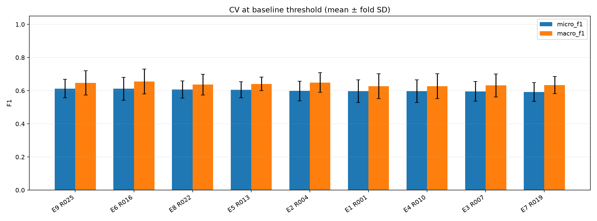
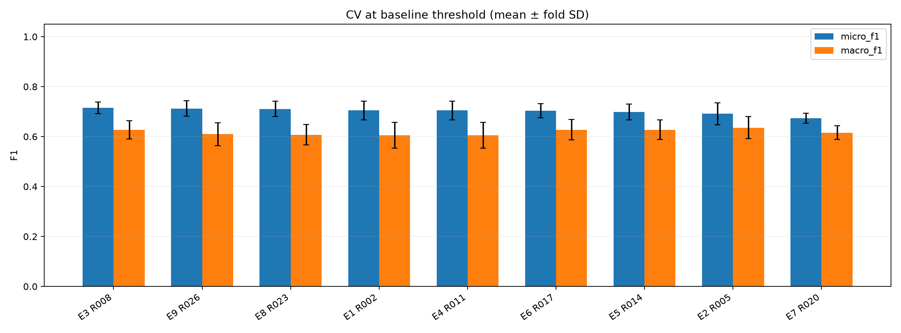
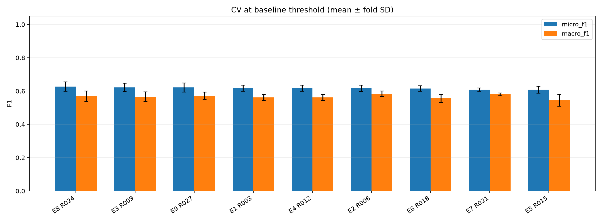

# Model Zoo results

## Registered models

| Model | Architecture | Completed runs |
|---|---|---:|
| E1 | RoBERTa + BCE | 3 |
| E2 | RoBERTa + Weighted BCE | 3 |
| E3 | RoBERTa + Focal Loss | 3 |
| E4 | RoBERTa + Threshold Tuning | 3 |
| E5 | RoBERTa + Label-Aware Attention | 3 |
| E6 | RoBERTa + Label-Aware Attention + Contrastive Loss | 3 |
| E7 | RoBERTa + Asymmetric Loss | 3 |
| E8 | RoBERTa + R-Drop | 3 |
| E9 | RoBERTa + Label Correlation (per-language GNN) | 3 |
| E10 | RoBERTa + Adversarial Training (FGM) | 0 |
| E11 | CodeBERT + BCE | 0 |
| E12 | RoBERTa + Label-Aware Attention + Label Correlation | 0 |
| E13 | CodeBERT + Head Learning Rate | 0 |
| E14 | CodeBERT + Layer-wise LR Decay | 0 |
| E15 | CodeBERT + R-Drop | 0 |
| E16 | CodeBERT + Layer-wise LR Decay + R-Drop | 0 |
| E17 | CodeBERT + Focal Loss | 0 |

Rows below are sorted by CV micro F1; test metrics are held-out reporting only.
CV ± SD describes variation across folds, not a confidence interval.
E4 CV scores use the baseline threshold; test scores use OOF-tuned thresholds.
Runs are compared only within the same language, data fingerprint, label order and split protocol.

Stage-1 screening uses 100% of the dataset: no full-train model or test evaluation is produced.
Future stage-2 test rows participated in method selection, so stage-2 test is exploratory.

## java / f6956a005541

Data fingerprint: `b47c89897374a4df4179067e514a7e76ad5a9f5ec776db9e51b817dfd0062ce0`. Split: `kfold_all_data`.

| Run | Model | CV micro F1 ± SD | Test micro F1 | Test macro F1 | Test macro AP | Hamming loss ↓ |
|---|---|---:|---:|---:|---:|---:|
| R025 | E9 | 0.6125 ± 0.0555 | — | — | — | — |
| R016 | E6 | 0.6115 ± 0.0688 | — | — | — | — |
| R022 | E8 | 0.6065 ± 0.0521 | — | — | — | — |
| R013 | E5 | 0.6055 ± 0.0488 | — | — | — | — |
| R004 | E2 | 0.5981 ± 0.0593 | — | — | — | — |
| R001 | E1 | 0.5968 ± 0.0688 | — | — | — | — |
| R010 | E4 | 0.5968 ± 0.0688 | — | — | — | — |
| R007 | E3 | 0.5954 ± 0.0590 | — | — | — | — |
| R019 | E7 | 0.5918 ± 0.0564 | — | — | — | — |

- R025: [exp9_roberta_label_gnn](../exp9/java/metrics.json); seed 42; device `cuda:0`; epochs None; checkpoint not produced in screening CV.
- R016: [exp6_roberta_label_attention_contrastive](../exp6/java/metrics.json); seed 42; device `cuda:0`; epochs None; checkpoint not produced in screening CV.
- R022: [exp8_roberta_rdrop](../exp8/java/metrics.json); seed 42; device `cuda:0`; epochs None; checkpoint not produced in screening CV.
- R013: [exp5_roberta_label_attention](../exp5/java/metrics.json); seed 42; device `cuda:0`; epochs None; checkpoint not produced in screening CV.
- R004: [exp2_roberta_weighted_bce](../exp2/java/metrics.json); seed 42; device `cuda:0`; epochs None; checkpoint not produced in screening CV.
- R001: [exp1_roberta_baseline](../exp1/java/metrics.json); seed 42; device `cuda:0`; epochs None; checkpoint not produced in screening CV.
- R010: [exp4_roberta_threshold_tuning](../exp4/java/metrics.json); seed 42; device `cuda:0`; epochs None; checkpoint not produced in screening CV.
- R007: [exp3_roberta_focal](../exp3/java/metrics.json); seed 42; device `cuda:0`; epochs None; checkpoint not produced in screening CV.
- R019: [exp7_roberta_asl](../exp7/java/metrics.json); seed 42; device `cuda:0`; epochs None; checkpoint not produced in screening CV.

## pharo / 9db102a8cd76

Data fingerprint: `e447db5e1bdde096bba0ea411b99215b54fd35d488db5f4e64dfe758ed97f3b8`. Split: `kfold_all_data`.

| Run | Model | CV micro F1 ± SD | Test micro F1 | Test macro F1 | Test macro AP | Hamming loss ↓ |
|---|---|---:|---:|---:|---:|---:|
| R008 | E3 | 0.7152 ± 0.0233 | — | — | — | — |
| R026 | E9 | 0.7124 ± 0.0304 | — | — | — | — |
| R023 | E8 | 0.7104 ± 0.0307 | — | — | — | — |
| R002 | E1 | 0.7044 ± 0.0374 | — | — | — | — |
| R011 | E4 | 0.7044 ± 0.0374 | — | — | — | — |
| R017 | E6 | 0.7036 ± 0.0278 | — | — | — | — |
| R014 | E5 | 0.6992 ± 0.0318 | — | — | — | — |
| R005 | E2 | 0.6912 ± 0.0445 | — | — | — | — |
| R020 | E7 | 0.6736 ± 0.0208 | — | — | — | — |

- R008: [exp3_roberta_focal](../exp3/pharo/metrics.json); seed 42; device `cuda:0`; epochs None; checkpoint not produced in screening CV.
- R026: [exp9_roberta_label_gnn](../exp9/pharo/metrics.json); seed 42; device `cuda:0`; epochs None; checkpoint not produced in screening CV.
- R023: [exp8_roberta_rdrop](../exp8/pharo/metrics.json); seed 42; device `cuda:0`; epochs None; checkpoint not produced in screening CV.
- R002: [exp1_roberta_baseline](../exp1/pharo/metrics.json); seed 42; device `cuda:0`; epochs None; checkpoint not produced in screening CV.
- R011: [exp4_roberta_threshold_tuning](../exp4/pharo/metrics.json); seed 42; device `cuda:0`; epochs None; checkpoint not produced in screening CV.
- R017: [exp6_roberta_label_attention_contrastive](../exp6/pharo/metrics.json); seed 42; device `cuda:0`; epochs None; checkpoint not produced in screening CV.
- R014: [exp5_roberta_label_attention](../exp5/pharo/metrics.json); seed 42; device `cuda:0`; epochs None; checkpoint not produced in screening CV.
- R005: [exp2_roberta_weighted_bce](../exp2/pharo/metrics.json); seed 42; device `cuda:0`; epochs None; checkpoint not produced in screening CV.
- R020: [exp7_roberta_asl](../exp7/pharo/metrics.json); seed 42; device `cuda:0`; epochs None; checkpoint not produced in screening CV.

## python / c6a49086848a

Data fingerprint: `5a27b3134e34bc78928e73296b38ac3bd6f26c07beccfdd6c55e14e1c70cddcc`. Split: `kfold_all_data`.

| Run | Model | CV micro F1 ± SD | Test micro F1 | Test macro F1 | Test macro AP | Hamming loss ↓ |
|---|---|---:|---:|---:|---:|---:|
| R024 | E8 | 0.6271 ± 0.0285 | — | — | — | — |
| R009 | E3 | 0.6219 ± 0.0256 | — | — | — | — |
| R027 | E9 | 0.6211 ± 0.0268 | — | — | — | — |
| R003 | E1 | 0.6169 ± 0.0177 | — | — | — | — |
| R012 | E4 | 0.6169 ± 0.0177 | — | — | — | — |
| R006 | E2 | 0.6161 ± 0.0199 | — | — | — | — |
| R018 | E6 | 0.6158 ± 0.0167 | — | — | — | — |
| R021 | E7 | 0.6081 ± 0.0102 | — | — | — | — |
| R015 | E5 | 0.6080 ± 0.0213 | — | — | — | — |

- R024: [exp8_roberta_rdrop](../exp8/python/metrics.json); seed 42; device `cuda:0`; epochs None; checkpoint not produced in screening CV.
- R009: [exp3_roberta_focal](../exp3/python/metrics.json); seed 42; device `cuda:0`; epochs None; checkpoint not produced in screening CV.
- R027: [exp9_roberta_label_gnn](../exp9/python/metrics.json); seed 42; device `cuda:0`; epochs None; checkpoint not produced in screening CV.
- R003: [exp1_roberta_baseline](../exp1/python/metrics.json); seed 42; device `cuda:0`; epochs None; checkpoint not produced in screening CV.
- R012: [exp4_roberta_threshold_tuning](../exp4/python/metrics.json); seed 42; device `cuda:0`; epochs None; checkpoint not produced in screening CV.
- R006: [exp2_roberta_weighted_bce](../exp2/python/metrics.json); seed 42; device `cuda:0`; epochs None; checkpoint not produced in screening CV.
- R018: [exp6_roberta_label_attention_contrastive](../exp6/python/metrics.json); seed 42; device `cuda:0`; epochs None; checkpoint not produced in screening CV.
- R021: [exp7_roberta_asl](../exp7/python/metrics.json); seed 42; device `cuda:0`; epochs None; checkpoint not produced in screening CV.
- R015: [exp5_roberta_label_attention](../exp5/python/metrics.json); seed 42; device `cuda:0`; epochs None; checkpoint not produced in screening CV.
