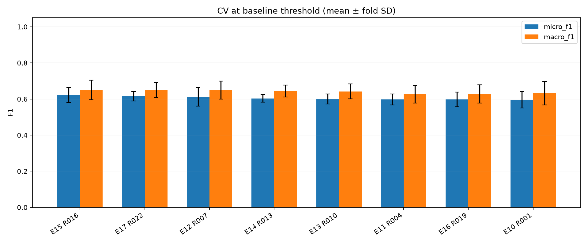
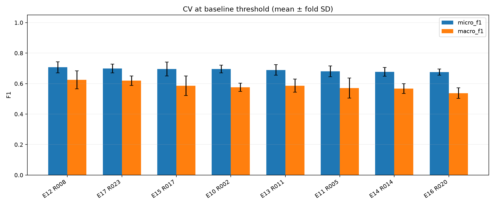
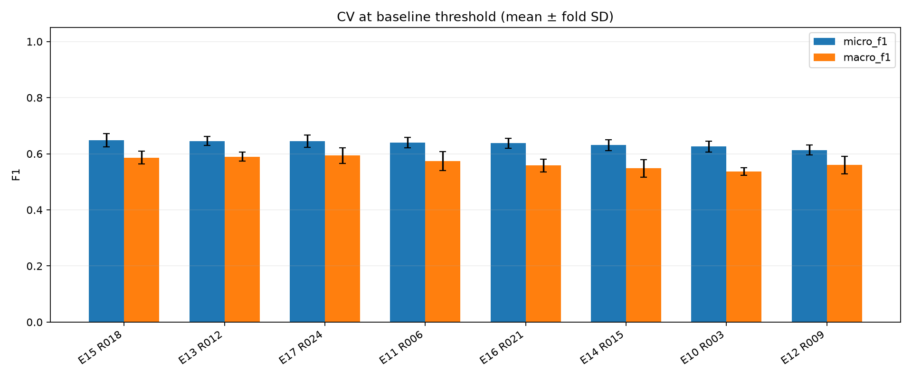

# Model Zoo results

## Registered models

| Model | Architecture | Completed runs |
|---|---|---:|
| E1 | RoBERTa + BCE | 0 |
| E2 | RoBERTa + Weighted BCE | 0 |
| E3 | RoBERTa + Focal Loss | 0 |
| E4 | RoBERTa + Threshold Tuning | 0 |
| E5 | RoBERTa + Label-Aware Attention | 0 |
| E6 | RoBERTa + Label-Aware Attention + Contrastive Loss | 0 |
| E7 | RoBERTa + Asymmetric Loss | 0 |
| E8 | RoBERTa + R-Drop | 0 |
| E9 | RoBERTa + Label Correlation (per-language GNN) | 0 |
| E10 | RoBERTa + Adversarial Training (FGM) | 3 |
| E11 | CodeBERT + BCE | 3 |
| E12 | RoBERTa + Label-Aware Attention + Label Correlation | 3 |
| E13 | CodeBERT + Head Learning Rate | 3 |
| E14 | CodeBERT + Layer-wise LR Decay | 3 |
| E15 | CodeBERT + R-Drop | 3 |
| E16 | CodeBERT + Layer-wise LR Decay + R-Drop | 3 |
| E17 | CodeBERT + Focal Loss | 3 |

Rows below are sorted by CV micro F1; test metrics are held-out reporting only.
CV ± SD describes variation across folds, not a confidence interval.
E4 CV scores use the baseline threshold; test scores use OOF-tuned thresholds.
Runs are compared only within the same language, data fingerprint, label order and split protocol.

Stage-1 screening uses 100% of the dataset: no full-train model or test evaluation is produced.
Future stage-2 test rows participated in method selection, so stage-2 test is exploratory.

## java / f6956a005541

Data fingerprint: `b47c89897374a4df4179067e514a7e76ad5a9f5ec776db9e51b817dfd0062ce0`. Split: `kfold_all_data`.

| Run | Model | CV micro F1 ± SD | Test micro F1 | Test macro F1 | Test macro AP | Hamming loss ↓ |
|---|---|---:|---:|---:|---:|---:|
| R016 | E15 | 0.6225 ± 0.0416 | — | — | — | — |
| R022 | E17 | 0.6154 ± 0.0259 | — | — | — | — |
| R007 | E12 | 0.6117 ± 0.0519 | — | — | — | — |
| R013 | E14 | 0.6032 ± 0.0205 | — | — | — | — |
| R010 | E13 | 0.6001 ± 0.0284 | — | — | — | — |
| R004 | E11 | 0.5980 ± 0.0300 | — | — | — | — |
| R019 | E16 | 0.5979 ± 0.0404 | — | — | — | — |
| R001 | E10 | 0.5957 ± 0.0462 | — | — | — | — |

- R016: [exp15_codebert_rdrop](../exp15/java/metrics.json); seed 42; device `cuda:1`; epochs None; checkpoint not produced in screening CV.
- R022: [exp17_codebert_focal](../exp17/java/metrics.json); seed 42; device `cuda:1`; epochs None; checkpoint not produced in screening CV.
- R007: [exp12_roberta_label_attention_gnn](../exp12/java/metrics.json); seed 42; device `cuda:1`; epochs None; checkpoint not produced in screening CV.
- R013: [exp14_codebert_llrd](../exp14/java/metrics.json); seed 42; device `cuda:1`; epochs None; checkpoint not produced in screening CV.
- R010: [exp13_codebert_head_lr](../exp13/java/metrics.json); seed 42; device `cuda:1`; epochs None; checkpoint not produced in screening CV.
- R004: [exp11_codebert_bce](../exp11/java/metrics.json); seed 42; device `cuda:1`; epochs None; checkpoint not produced in screening CV.
- R019: [exp16_codebert_llrd_rdrop](../exp16/java/metrics.json); seed 42; device `cuda:1`; epochs None; checkpoint not produced in screening CV.
- R001: [exp10_roberta_fgm](../exp10/java/metrics.json); seed 42; device `cuda:1`; epochs None; checkpoint not produced in screening CV.

## pharo / 9db102a8cd76

Data fingerprint: `e447db5e1bdde096bba0ea411b99215b54fd35d488db5f4e64dfe758ed97f3b8`. Split: `kfold_all_data`.

| Run | Model | CV micro F1 ± SD | Test micro F1 | Test macro F1 | Test macro AP | Hamming loss ↓ |
|---|---|---:|---:|---:|---:|---:|
| R008 | E12 | 0.7068 ± 0.0367 | — | — | — | — |
| R023 | E17 | 0.6993 ± 0.0287 | — | — | — | — |
| R017 | E15 | 0.6956 ± 0.0450 | — | — | — | — |
| R002 | E10 | 0.6950 ± 0.0253 | — | — | — | — |
| R011 | E13 | 0.6893 ± 0.0347 | — | — | — | — |
| R005 | E11 | 0.6805 ± 0.0358 | — | — | — | — |
| R014 | E14 | 0.6767 ± 0.0282 | — | — | — | — |
| R020 | E16 | 0.6748 ± 0.0202 | — | — | — | — |

- R008: [exp12_roberta_label_attention_gnn](../exp12/pharo/metrics.json); seed 42; device `cuda:1`; epochs None; checkpoint not produced in screening CV.
- R023: [exp17_codebert_focal](../exp17/pharo/metrics.json); seed 42; device `cuda:1`; epochs None; checkpoint not produced in screening CV.
- R017: [exp15_codebert_rdrop](../exp15/pharo/metrics.json); seed 42; device `cuda:1`; epochs None; checkpoint not produced in screening CV.
- R002: [exp10_roberta_fgm](../exp10/pharo/metrics.json); seed 42; device `cuda:1`; epochs None; checkpoint not produced in screening CV.
- R011: [exp13_codebert_head_lr](../exp13/pharo/metrics.json); seed 42; device `cuda:1`; epochs None; checkpoint not produced in screening CV.
- R005: [exp11_codebert_bce](../exp11/pharo/metrics.json); seed 42; device `cuda:1`; epochs None; checkpoint not produced in screening CV.
- R014: [exp14_codebert_llrd](../exp14/pharo/metrics.json); seed 42; device `cuda:1`; epochs None; checkpoint not produced in screening CV.
- R020: [exp16_codebert_llrd_rdrop](../exp16/pharo/metrics.json); seed 42; device `cuda:1`; epochs None; checkpoint not produced in screening CV.

## python / c6a49086848a

Data fingerprint: `5a27b3134e34bc78928e73296b38ac3bd6f26c07beccfdd6c55e14e1c70cddcc`. Split: `kfold_all_data`.

| Run | Model | CV micro F1 ± SD | Test micro F1 | Test macro F1 | Test macro AP | Hamming loss ↓ |
|---|---|---:|---:|---:|---:|---:|
| R018 | E15 | 0.6479 ± 0.0237 | — | — | — | — |
| R012 | E13 | 0.6455 ± 0.0163 | — | — | — | — |
| R024 | E17 | 0.6452 ± 0.0219 | — | — | — | — |
| R006 | E11 | 0.6397 ± 0.0181 | — | — | — | — |
| R021 | E16 | 0.6376 ± 0.0175 | — | — | — | — |
| R015 | E14 | 0.6307 ± 0.0196 | — | — | — | — |
| R003 | E10 | 0.6260 ± 0.0196 | — | — | — | — |
| R009 | E12 | 0.6132 ± 0.0181 | — | — | — | — |

- R018: [exp15_codebert_rdrop](../exp15/python/metrics.json); seed 42; device `cuda:1`; epochs None; checkpoint not produced in screening CV.
- R012: [exp13_codebert_head_lr](../exp13/python/metrics.json); seed 42; device `cuda:1`; epochs None; checkpoint not produced in screening CV.
- R024: [exp17_codebert_focal](../exp17/python/metrics.json); seed 42; device `cuda:1`; epochs None; checkpoint not produced in screening CV.
- R006: [exp11_codebert_bce](../exp11/python/metrics.json); seed 42; device `cuda:1`; epochs None; checkpoint not produced in screening CV.
- R021: [exp16_codebert_llrd_rdrop](../exp16/python/metrics.json); seed 42; device `cuda:1`; epochs None; checkpoint not produced in screening CV.
- R015: [exp14_codebert_llrd](../exp14/python/metrics.json); seed 42; device `cuda:1`; epochs None; checkpoint not produced in screening CV.
- R003: [exp10_roberta_fgm](../exp10/python/metrics.json); seed 42; device `cuda:1`; epochs None; checkpoint not produced in screening CV.
- R009: [exp12_roberta_label_attention_gnn](../exp12/python/metrics.json); seed 42; device `cuda:1`; epochs None; checkpoint not produced in screening CV.
